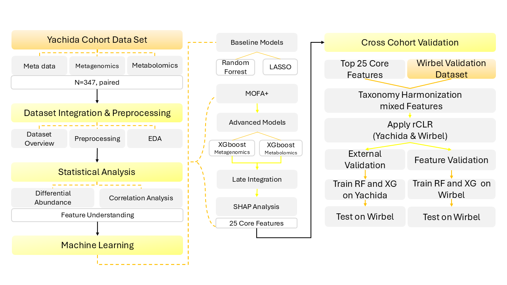

# Colorectal Cancer Multi-Omics Analysis

Exploring gut microbiome and metabolome signatures across colorectal neoplasia stages using statistical analysis, machine learning and multi-omics integration.

**Python · Bioinformatics · Statistical analysis · Machine learning · Multi-omics**

This collaborative MSc Bioinformatics project at Freie Universität Berlin analyzes 347 paired samples from the Yachida et al. (2019) cohort. It compares microbial and metabolite features, baseline classifiers, XGBoost and MOFA+ representations, with external microbiome validation using Wirbel et al. (2019).

## My contributions — Jaskirat Kaur Sohal

My contributions to the group project included exploratory analysis and visualization, Mann–Whitney U testing with Benjamini–Hochberg correction, Spearman genus–metabolite analysis, Random Forest and LASSO baseline modelling, and results visualization and interpretation.

Start with the exploratory, statistical and baseline notebooks below. These notebooks form part of a shared team workflow; this section does not claim exclusive authorship of entire files. The archive also includes `notebooks/appendix/Week3_Jaskirat_xgboost_raw.ipynb`, explicitly named for my Week 3 work.

## Analysis workflow

| Step | Notebook | Focus |
|---|---|---|
| 1 | [Dataset overview](notebooks/01_DatasetOverview.ipynb) | Sample matching, quality checks and cohort overview |
| 2 | [Exploratory analysis](notebooks/02_Yachida_PCA_UMAP.ipynb) | PCA, UMAP and cohort comparisons |
| 3 | [Statistical analysis](notebooks/03_StatisticalAnalysis.ipynb) | Differential abundance and microbial–metabolite correlations |
| 4 | [Baseline models](notebooks/04_AllStages_Yachida_RF_LASSO.ipynb) | Random Forest and LASSO |
| 5 | [Early-stage analysis](notebooks/05.0_EarlyStages_Yachida_MOFA_XGBoost.ipynb) | MOFA+ and supervised modelling |
| 6 | [Later-stage raw features](notebooks/05.1_xgboost_LaterStage_raw_features.ipynb) | XGBoost and late integration |
| 7 | [Nested cross-validation](notebooks/05.1.1_Raw_later_stage_nested_cv_xgb_rf.ipynb) | Model tuning and outer-fold evaluation |
| 8 | [MOFA feature analysis](notebooks/05.2_LaterStage_MOFA_Feature_analysis.ipynb) | Factors, feature interpretation and SHAP |
| 9 | [MOFA factor modelling](notebooks/05.2.1_mofa_factor_later_stage_.ipynb) | Later-stage factor-based analysis |
| 10 | [MOFA feature classification](notebooks/05.3_xgboost_LaterStage_MOFA_features.ipynb) | Classification using MOFA representations |
| 11 | [Cross-cohort validation](notebooks/06_cross_cohort_validation.ipynb) | Taxonomy alignment and independent-cohort evaluation |

## Selected findings and evaluation

The statistical analysis identified CRC-associated genera including Parvimonas, RGIG1874, Lonepinella and Lachnospira. The notebooks explore their metabolite associations and the predictive information in microbial and metabolic profiles.

Saved output in `05.1_xgboost_LaterStage_raw_features.ipynb` reports species XGBoost mean ROC-AUC **0.846 ± 0.116** and genus XGBoost mean ROC-AUC **0.820 ± 0.103** across ten folds. A separate late-integration output in that notebook reports ROC-AUC **0.836**. These values describe the archived runs; the notebook also contains other evaluation outputs. Consult the nested-CV notebook for the separate tuning and evaluation experiment.

The original team README reports external XGBoost ROC-AUC of **0.5487** for the three-feature early-stage signature and **0.7108** for the seven-feature later-stage signature. The reduction in external performance highlights limits to cross-cohort transferability. These external values are team-reported results, not newly reproduced here.

Different feature sets, splits and evaluation procedures produce different metrics. This is an exploratory research project, and the models have not been established as clinical diagnostic tools.

## Repository contents

- `notebooks/`: eleven main analysis notebooks and one appendix notebook.
- `data/`: archived validation spreadsheets, an aligned validation CSV and a genus count table.
- `results/figures/`: saved plots, including statistical, SHAP, MOFA and validation figures.
- `results/*.zip`: archived outputs from selected analysis stages.

## Running the notebooks

The archive is a project snapshot rather than a fully packaged executable pipeline. It does not include a tested environment lockfile or all primary input data. Existing notebook outputs can be viewed without rerunning the analysis.

1. Create a Python environment and install the packages imported by the relevant notebook. Common dependencies include NumPy, pandas, SciPy, statsmodels, scikit-learn, matplotlib, seaborn, umap-learn, XGBoost, SHAP, mofapy2, h5py, openpyxl, requests and Jupyter.
2. Obtain the Yachida inputs from the [curated microbiome–metabolome repository](https://github.com/borenstein-lab/microbiome-metabolome-curated-data), referenced in the existing notebooks. Required files vary by notebook and include `metadata.tsv`, `species.tsv.zip`, `genera.tsv`, `mtb.tsv` and `mtb.map.tsv`.
3. Check input paths before execution. Some notebooks expect files under `data/`; the statistical notebook uses filenames relative to its working directory. Several notebooks download source data themselves.
4. The external-validation notebook contains Google Colab and Google Drive paths. Adapt these to your environment and the included validation files before running it locally.
5. Run the relevant notebook and review preprocessing, feature selection and evaluation cells before interpreting results.

The documentation preparation did not rerun model training or validate end-to-end reproducibility.

## Team and attribution

**Group 6:** Xiaolin Lai, Jaskirat Kaur Sohal and Jiaqi Li.

The complete analysis is a team project. Scientific findings and model results are credited to the group; my individual work is described above.

Original project: [FU Berlin GitLab repository](https://git.imp.fu-berlin.de/crc_multiomics_project/crc_multiomics_project_group6/-/tree/main).

This copy originates from a downloaded main-branch ZIP, which contains source files and saved outputs but no Git history. Importing or cloning the original Git repository is required to preserve original commits and author attribution.

## Data sources and reuse

- Yachida et al. (2019). *Metagenomic and metabolomic analyses reveal distinct stage-specific phenotypes of the gut microbiota in colorectal cancer.* Nature Medicine, 25, 968–976.
- Wirbel et al. (2019). *Meta-analysis of fecal metagenomes reveals global microbial signatures that are specific for colorectal cancer.* Nature Medicine, 25, 679–689.

No license file is included in the supplied archive. Data remain subject to their source terms; this portfolio documentation does not grant redistribution or reuse rights.

## AI assistance disclosure

The original team documentation states that AI assistance supported code organization, debugging, documentation and explanations. The team reviewed scientific decisions and conclusions. This portfolio README was prepared with AI assistance from the supplied archive and the contributor's description of her role.
